# BenchWitness — phase and GitHub delivery plan

**Pre-event planning note only.** Do not initialize or scaffold the implementation, create implementation commits, or publish the working project until **15 October 2026, 00:01 IST** and an explicit human kickoff. The current notes directory is not yet a Git repository. This plan complements [PROJECT_BLUEPRINT.md](PROJECT_BLUEPRINT.md), [PRE_EVENT_STRATEGY.md](PRE_EVENT_STRATEGY.md), and the first [kickoff prompt](CODEX_KICKOFF_PROMPT.md).

The data inputs and controls for Phases 2–5 are listed in [DATASET_INVENTORY.md](DATASET_INVENTORY.md).

## Delivery rule

Each phase is a small vertical slice with a visible result and an acceptance gate. At its gate: run the relevant local checks, inspect the diff, record failures, make one or more coherent commits, push, verify the GitHub commit and CI status, then obtain human review before starting the next milestone. A failed gate is fixed in the same phase; it is not described as passed. Commit messages describe behavior, not a claim that every test passed.

No paid service is required. The runtime is local Docker Compose plus a local frontend/API/worker. A public GitHub repository and standard public-repository GitHub Actions are available on [GitHub Free](https://docs.github.com/en/repositories/creating-and-managing-repositories/about-repositories); [standard public-repository Actions runners are free](https://docs.github.com/en/actions/how-tos/write-workflows/choose-where-workflows-run/choose-the-runner-for-a-job). Use only standard runners, avoid paid storage/large runners, and keep local commands sufficient if CI is unavailable.

## Phase map

```mermaid
flowchart LR
    A[Oct 15<br/>1. Foundation] -->|Gate| B[2. Lineage audit]
    B -->|Gate| C[Oct 16<br/>3. Real experiments]
    C -->|Gate| D[4. Impact and approval]
    D -->|Gate| E[5. Clean recovery]
    E -->|Gate| F[Oct 17<br/>6. Agent and memory]
    F -->|Gate| G[7. Investigation UI]
    G -->|Gate| H[Oct 18<br/>8. Release and submission]
    H -->|Final gate| I[Public repo and submission]
```

Every gate means: run checks, review the diff, commit, push, verify the GitHub SHA and CI, then obtain human milestone review. The arrows show planned order, not automatic permission to advance.

| Phase | Target | Build slice after kickoff | Acceptance gate | Planned commit(s) |
|---|---|---|---|---|
| 1. Foundation | Oct 15 | Repo layout; `uv`; Vite/TypeScript; Compose with **separate** FalkorDB and Redis; API `/healthz` and `/readyz`; graph reachability CLI; `.env.example`; macOS commands | Real FalkorDB integration test, API smoke test, lint/type/build checks pass; local start works | `chore: establish local runtime and quality gates`; `feat(api): report graph readiness` |
| 2. Lineage | Oct 15 | Synthetic manifest, stable canonical source IDs, sample derivation and dataset membership ingestion in FalkorDB | One contaminated source is confirmed by two membership paths; same-family disjoint control is not confirmed; missing provenance is unknown | `feat(graph): ingest versioned sample lineage`; `feat(audit): prove exact source overlap` |
| 3. Real experiments | Oct 16 | Small CPU-only training/evaluation runs, immutable artifacts and checksums, actual run-to-dataset edges | Scores come from predictions; rerun with same seed is reproducible within documented tolerance; graph points to exact consumed manifests | `feat(ml): record measured experiment versions` |
| 4. Impact and approval | Oct 16 | Traversal from a finding through model/evaluation/metric dependencies; quarantine proposal and explicit approval | All and only dependent claims appear; without approval no mutation occurs; originals remain | `feat(impact): trace affected evaluation claims`; `feat(actions): require approval for quarantine` |
| 5. Clean recovery | Oct 16–17 | Separate Redis-backed job; clean split reconstruction; refit and re-evaluation; appended model/evaluation versions | Approved job reaches a measured outcome; duplicate request is idempotent; failure is visible; old versions remain queryable | `feat(worker): run approved clean re-evaluation` |
| 6. Agent and memory | Oct 17 | Typed, bounded graph tools; graph-driven tool selection; verified investigation memory across sessions | A fresh session retrieves prior evidence and changes its next action when relevant; stale memory triggers verification | `feat(agent): investigate with bounded graph tools`; `feat(memory): recall verified findings across sessions` |
| 7. Investigation UI | Oct 17 | Opensource UI product shell; real experiment list; bounded Cytoscape evidence path; impact, approval, job progress, before/after | Judge finishes full workflow in UI; no fake values; keyboard and failure-state checks; UI matches API | `feat(web): show evidence and recovery workflow` |
| 8. Release and submission | Oct 18 | Fresh-volume end-to-end test; README, graph model, key Cypher, setup/seed commands, AI disclosure, video, public submission | Complete local setup works from blank volumes; demo video shows actual outputs; public repo and submission links verified before 23:59 IST | `test: cover full seeded investigation and repair`; `docs: publish reproducible demo and submission` |

These are target slices, not a license to move to the next milestone automatically. If schedule slips, preserve graph-backed evidence, measured rerun, approval, memory, and a usable UI; cut extra algorithms, broad import, optional local model, and visual polish.

## Commit and push protocol

1. **At kickoff:** confirm local IST time and current rules. Create the repository with `.gitignore` before adding artifacts or environment files. Keep pre-event notes visibly labeled as such. The first implementation commit timestamp should be after the event opens; never rewrite dates to imply work happened later.
2. **Create a free public GitHub repository** during the event, or keep local until its initial content has been checked for secrets and rights. A public repository is required for submission. Decide its owner/name with the human; do not invent a remote URL. GitHub documents the [existing-local-repo publishing flow](https://docs.github.com/en/migrations/importing-source-code/using-the-command-line-to-import-source-code/adding-locally-hosted-code-to-github).
3. **Stage by slice, inspect before commit:** `git status --short`, `git diff --check`, and `git diff --cached --stat`/`git diff --cached` after staging. Keep each commit focused enough to review and revert. Do not bundle unrelated UI, graph, worker, and docs changes because they happened on the same day.
4. **Run the phase gate before a success commit:** use the commands established in Phase 1. Record actual commands and results in the milestone report or PR. Do not mark integration tests passed when FalkorDB was not running.
5. **Push after every accepted phase**, then verify the remote branch/commit and any CI run. Keep a local commit even if network publishing temporarily fails; report the push failure and retry before submission. Never force-push the shared/default branch just to tidy history.
6. **Review and merge:** for a solo four-day build, short `phase/01-foundation` style branches and small PRs are useful if human review is available quickly; otherwise make reviewed commits on `main` and push after each gate. For a team, use short branches and PRs to avoid overwriting others. Human review of meaningful product and destructive-action decisions remains mandatory.
7. **Tag the reviewed release** near submission (for example `hackathon-2026`) after the fresh-start gate and video are verified. Record the exact tag and commit hash in the submission notes. A tag identifies a tested state; it does not replace testing.

### Repository hygiene

- Track source, tests, small synthetic generation recipes, manifest examples, lockfiles, Compose configuration, `.env.example`, docs, and license/attribution for copied Opensource UI components.
- Ignore `.env`, tokens, caches, virtual environments, Docker volumes, model binaries, generated datasets, and large video files. Document how to regenerate demo artifacts. Do not store restricted data or secrets in Git history.
- Use a small public CI workflow only after local commands are reliable: backend lint/type/unit and graph integration service, frontend lint/type/build, then an end-to-end smoke gate if it fits standard runners. Pin actions and dependencies once verified during the event.
- Never claim a green GitHub commit until the pushed SHA and checks are actually visible. A local commit, a successful push, a passing CI run, a reviewed milestone, and a submitted release are distinct states.

## Day-end checkpoints

| Day | GitHub state to aim for | Recovery if behind |
|---|---|---|
| Oct 15 | Foundation and lineage commits pushed; graph integration test visible | Stop UI/agent work; make exact overlap and clean control pass |
| Oct 16 | Measured runs, impact, approval, and recovery commits pushed | Reduce to one lightweight model configuration, keep two affected evaluations |
| Oct 17 | Agent/memory and UI commits pushed; complete path usable | Reduce UI to one investigation screen and one approval flow |
| Oct 18 | Fresh-start test, docs, disclosure and video committed; reviewed tag and public repo link submitted | Freeze features early; fix setup/demo blockers and submit a truthful local demo |

## Submission proof checklist

- Public repo URL and reviewed tag/SHA resolve in a logged-out browser.
- README includes exact local setup, seed, test, graph model, and key Cypher/query explanations.
- Demo video shows actual evidence paths, approval, measured worker rerun, and new-session recall from FalkorDB.
- Track selection, permitted data source, AI-assistance disclosure, and any limitations are explicit.
- The human can explain the graph path, why the clean control is clean only within recorded lineage, why an old score remains, and how the new score was computed.

The [hackathon rules](https://www.wemakedevs.org/hackathons/falkordb/rules) set the Oct 15–18 IST window and require the public repo, graph model, key queries, setup, working video, and track selection. Recheck them before kickoff and submission.
